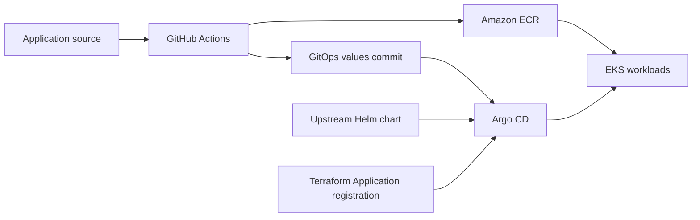

# otel-demo-gitops-aws

AWS application desired state for a platform engineering lab using **Amazon EKS,
Argo CD, Helm, and Amazon ECR**. Argo CD combines the upstream OpenTelemetry Demo
Helm chart with this repository's environment-specific values and reconciles
the resulting Kubernetes workloads.

## Engineering focus

The application is the upstream OpenTelemetry Demo. This repository demonstrates
how to deliver and configure it through GitOps:

- A multi-source Argo CD Application separates the upstream chart from AWS values.
- The Recommendation image override supports independent application releases.
- Automated synchronization enables pruning and self-healing.
- AWS desired state is isolated from the local kind environment.
- Terraform registers the Application; Argo CD owns its workloads.

## Delivery architecture

Application code and release workflows live in [otel-demo-apps](https://github.com/lackito/otel-demo-apps). AWS
provisioning and platform setup live in [otel-demo-infra-aws](https://github.com/lackito/otel-demo-infra-aws).

## Inspect the implementation

| File | What it demonstrates |
|---|---|
| [Argo CD Application](argocd/applications/otel-demo.yaml) | Multi-source chart and values configuration, destination, and sync policy |
| [Helm values](applications/otel-demo/values.yaml) | Observability settings and the Recommendation ECR image override |
| [Operations guide](docs/OPERATIONS.md) | Setup dependencies, synchronization, release verification, and ownership boundaries |

The committed values use a commit-shaped image tag for Recommendation. The
operations guide describes the GitHub Actions → ECR → GitOps update workflow.
To verify a particular release, match its workflow run, generated GitOps commit,
Argo CD revision, and deployed image. Configuration alone does not prove that
the cluster is currently healthy.

## Scope and status

Recommendation currently has the active custom-image override. Product Catalog
and Ad delivery implementation is prepared; activation awaits real ECR images
and successful release validation as described in the operations guide. This does not
mean the upstream chart's corresponding services are necessarily disabled.

Infrastructure, IAM, ECR, and platform components are managed outside this
repository. Local Kubernetes values belong in
[otel-demo-gitops-kind](https://github.com/lackito/otel-demo-gitops-kind).

## Explore the full project

- [Local Kubernetes platform](https://github.com/lackito/otel-demo-infra-kind): cluster lifecycle, platform Terraform, and validation scripts.
- [AWS and local walkthrough](https://github.com/lackito/otel-demo-infra-kind/blob/main/docs/PROJECT_WALKTHROUGH.md): delivery paths and ownership boundaries.
- [Operations guide](docs/OPERATIONS.md): detailed AWS GitOps reference and future improvements.

## Environment naming

See the shared [naming and migration guide](https://github.com/lackito/otel-demo-apps/blob/main/docs/NAMING.md) for repository names, runtime identities, and the coordinated rename sequence.
